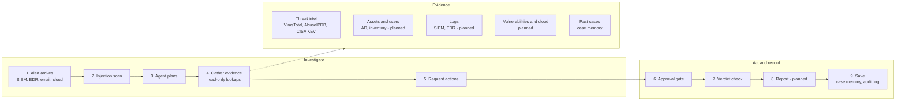

# How the agent handles an alert

Every alert ends with a verdict, a report and a saved case. Steps marked *planned* are on the
[roadmap](ARCHITECTURE.md#roadmap) and not built yet.

| Step | What happens | Kind | Where |
|---|---|---|---|
| 1. Alert arrives | An alert is handed to the agent. Today this is a JSON file; later it is pulled from the SIEM or EDR. | Agent | `agent/main.py` |
| 2. Injection scan | The alert is scanned for text that tries to instruct the AI, then wrapped as untrusted data. | Guardrail | `agent/guardrails.py` |
| 3. Agent plans | Claude decides what to check first. | Agent | `agent/agent.py` |
| 4. Gather evidence | Read-only lookups. Every result is scanned and wrapped as untrusted data too. | Agent | `agent/tools.py` |
| 5. Request actions | The agent may ask to isolate a host, block an IP, disable a user or open a ticket. | Agent | `agent/tools.py` |
| 6. Approval gate | Allowlist, target checks and critical-asset protection. High-risk actions wait for a human. All actions are dry-run. | Guardrail | `ActionGate` |
| 7. Verdict check | The verdict must match a strict schema. Low confidence, or a false-positive verdict when injection was seen, is escalated to a human. | Guardrail | `validate_verdict` |
| 8. Report *(planned)* | One report per investigation with a unique ID, showing where the alert came from, the evidence trail and the outcome. | Agent | planned `agent/report.py` |
| 9. Save | The run is written to the audit log and, if it completed, to case memory. | Agent | `agent/audit.py`, `agent/memory.py` |

## Evidence sources

| Source | Status | Tool |
|---|---|---|
| Threat intel: local file, VirusTotal, AbuseIPDB, CISA KEV | Built | `lookup_ip_reputation`, `lookup_domain_reputation`, `lookup_file_hash`, `lookup_cve` |
| Past cases | Built | `search_past_cases` |
| Assets and users | Mock data today; Active Directory / Entra ID and inventory planned | `get_asset_info`, `get_user_info` |
| Logs | Mock data today; SIEM and EDR over MCP planned | `search_related_events` |
| Vulnerabilities and cloud | Planned | via MCP servers |
