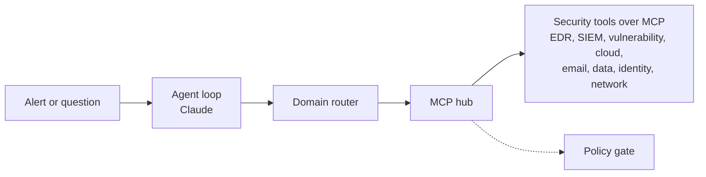

# Architecture and roadmap: multi-tool security agent

The goal is to grow this triage agent into one guarded agent that reaches every security tool
through MCP (Model Context Protocol) servers. Scope is detection and remediation; the agent does
not exploit anything.

For the step-by-step path of a single alert, see [ALERT_FLOW.md](ALERT_FLOW.md).

## Target design

The agent loop, audit log and verdict validation stay as they are. Three things change:

1. **MCP hub replaces the hard-coded tools.** A new `agent/mcp_hub.py` reads `servers.yaml`, connects
   to each MCP server and exposes its tools under a namespace (`crowdstrike__...`, `secops__...`).
   Today's mock tools become one "local" provider, so `--mock` and the tests keep working offline.
2. **Domain routing.** Some servers expose hundreds of tools, so the model cannot be given all of
   them at once. A router picks the domain (endpoint, vulnerability, cloud, email, data, identity,
   network) and loads only those tools, or hands off to a per-domain sub-agent.
3. **A policy file drives the action gate.** `ActionGate` knows four actions today. It becomes a
   `policy.yaml` that classifies every MCP tool as read, low-risk write or high-risk write.
   Anything unclassified is denied.

Playbooks sit on top: alert triage (built), vulnerability prioritization, phishing investigation,
cloud misconfiguration, identity compromise and DLP incidents. They share one entity model (host,
user, IP, domain, hash, mailbox, cloud resource) so a finding from one tool can be looked up in
another.

## Detection and remediation

**Detection**
- Pull findings from scanners and cloud tools through their MCP servers.
- Correlate across tools: is the CVE known to be exploited, is the asset internet-facing, is EDR
  installed, has the SIEM seen suspicious activity there?
- Rank what matters, so the output is a short list of real risks.

**Remediation**
- Write the fix for each finding: patch or version, config change, or a compensating control.
- Open tickets to the right owner with evidence attached.
- Containment (isolate, block, disable) only through the approval gate.
- Re-check after the fix to confirm the finding is closed.

## Reporting

A planned `agent/report.py` turns the JSONL audit log into one report per investigation, each with a
unique ID: where the alert came from (source tool, original alert ID, detection rule, link back),
the evidence trail, the outcome, and remediation. Reports are pushed to a configured sink (ticket,
SOAR case, chat message, HTML/PDF). Pushing a report is a low-risk write.

## Assets and identity

`get_asset_info` and `get_user_info` become real lookups that merge several sources into one record
(owner, criticality, OS, last seen, EDR installed):

- **Identity:** on-prem Active Directory through a read-only LDAP account, or Entra ID.
- **Assets:** EDR host inventory, scanner asset lists, cloud inventory, and a CMDB if present.

Asset criticality feeds the rule that blocks automatic isolation of critical systems, and comparing
sources exposes coverage gaps such as machines in AD with no EDR agent.

## MCP server map

Checked in November 2026. This area moves fast; verify status before relying on any entry.

| Category | Server | Status when checked |
|---|---|---|
| EDR | [CrowdStrike falcon-mcp](https://github.com/CrowdStrike/falcon-mcp) | Maintained by CrowdStrike, preview |
| EDR | [SentinelOne purple-mcp](https://github.com/Sentinel-One/purple-mcp) | Vendor-published |
| SIEM/SOAR | Google SecOps (Chronicle) | Google-hosted remote server available |
| SIEM | Splunk | Official app on Splunkbase, beta |
| SIEM/XDR | Microsoft Sentinel | Microsoft-hosted; also covers Defender triage |
| Vulnerability | Rapid7 | Open-source Bulk Export server from Rapid7 |
| Vulnerability | Qualys, Tenable/Nessus | Community servers only found; vet or write your own |
| Cloud | Wiz | Preview for Wiz customers |
| Cloud/network | Palo Alto Cortex | Cortex MCP Server |
| Email | Proofpoint | Community servers for TAP/Essentials; no official one found |
| Data/DLP | Microsoft Purview | Reachable through Sentinel's data lake |
| Data/DLP | Proofpoint DLP | None found; would need a custom server |
| Identity | [Okta](https://github.com/okta/okta-mcp-server) | Official open-source server |
| Identity | Entra ID | Microsoft MCP Server for Enterprise (Graph) |
| Identity | On-prem Active Directory | None verified; likely a small custom server |
| Network | Zscaler | Official; read-only unless writes are enabled |
| Threat intel | Google Threat Intelligence | VirusTotal data through Google |

Not yet checked: AWS, Azure and GCP native servers, and ticketing (Jira, ServiceNow).

## Guardrails to add for MCP

The existing guardrails carry over (injection scanning, untrusted-data wrapping, approval gate,
kill switch, audit log). MCP adds new risks, so:

- **Pin tool descriptions.** Hash each server's tool list on first approval and refuse to run if it
  changes, since a description can be swapped for a malicious one later.
- **Scan tool descriptions**, not just tool output, with the injection patterns.
- **Block read-to-write chains.** Attacker-controlled content from one tool must never become the
  argument to a high-risk action without human approval.
- **One least-privilege credential per server**, read scopes only, from environment variables or a vault.
- **Pin server versions** and run third-party servers in containers.

## Roadmap

| Step | Work | Needs vendor accounts |
|---|---|---|
| Done | Threat intelligence, case memory, 12-alert eval set | No |
| 1 | Tool-provider interface in front of `ToolExecutor` | No |
| 2 | MCP hub, mock MCP servers, `policy.yaml`, description pinning, report generator | No |
| 3 | First real connectors, read-only: EDR and SIEM; AD and asset lookups; report push | Yes |
| 4 | Vulnerability and cloud connectors; first cross-tool playbook | Yes |
| 5 | Email, data, identity and network, including custom servers for gaps | Yes |
| 6 | Approved actions out of dry-run, with chat or ticket approvals | Yes |

Use real tenants only with the owning organization's approval.

## Ideas for later

Alert correlation into incidents, an environment-knowledge file, a phishing mailbox workflow,
threat hunting from a hypothesis, drafting detection rules after confirmed true positives, a web
interface, scheduled digests, a metrics dashboard, role-based approvals, compliance mapping, data
redaction before model calls, and per-investigation cost limits.
